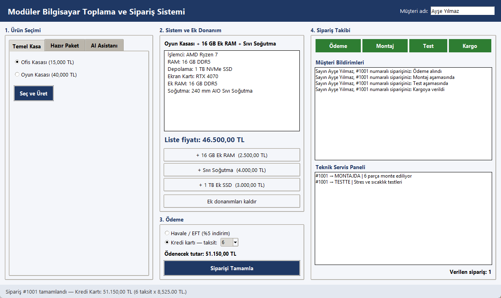

# Modüler Bilgisayar Toplama ve Sipariş Sistemi

EBLG443 Tasarım Kalıpları — Dönem Projesi · Python 3.10+ (`abc.ABC`)

Temel kasaları ve hazır paketleri fabrikalar üzerinden üreten, ek donanımları çalışma
anında sarmalayan, ödeme algoritmalarını değiştirilebilir kılan, montaj/kargo aşamalarını
ilgili panellere bildiren ve müşteriye AI destekli donanım önerisi sunan bir sipariş sistemi.

## Kullanılan Kalıplar

| Kalıp | Grup | Dosya | Çözdüğü problem |
|---|---|---|---|
| Factory Method | Yaratımsal | `pc_siparis/fabrika.py` | İstemcinin somut kasa/paket sınıflarına bağımlılığı, ortak üretim sürecinin tekrarı |
| Decorator | Yapısal | `pc_siparis/dekoratorler.py` | Donanım kombinasyonlarında sınıf patlaması |
| Strategy | Davranışsal | `pc_siparis/odeme.py`, `pc_siparis/siparis.py` | Ödeme yöntemleri için if/else zinciri |
| Observer | Davranışsal | `pc_siparis/takip.py` | Sipariş akışının bildirim modüllerine bağımlılığı |
| Adapter | Yapısal | `pc_siparis/ai/dil_modeli.py` | Asistanın LLM SDK'sına bağımlılığı, anahtarsız test edilememesi |
| Command | Davranışsal | `pc_siparis/ai/araclar.py` | Modelin araç isteklerinin if/else ile karşılanması |
| Tool Use, Guardrail | LLM | `pc_siparis/ai/` | Modelin fiyat/parça uydurması, bütçe dışı öneri, prompt injection |

Kodda her rol, sınıfın üstünde `# [Kalıp: Rol]` yorumuyla işaretlidir.
Ayrıntılı rol tabloları, UML sınıf ve sıralama diyagramları: [docs/KALIP_HARITASI.md](docs/KALIP_HARITASI.md).
Tasarım raporu (Word): [docs/Tasarim_Raporu.docx](docs/Tasarim_Raporu.docx) · UML görselleri: [docs/uml/](docs/uml/).

**Dokümanlar:** [Kurulum ve çalıştırma](docs/KURULUM.md) · [Test dokümanı](docs/TEST.md)

## Proje Yapısı

```
pc_siparis/
  urunler.py       IBilgisayar, OfisKasasi, OyunKasasi
  fabrika.py       BilgisayarFabrikasi, StandartSistemFabrikasi, HazirPaketFabrikasi
  dekoratorler.py  DonanimDecorator ve somut donanım dekoratörleri
  katalog.py       DonanimKatalogu (kod → dekoratör)
  odeme.py         IOdemeStratejisi ve somut ödeme stratejileri
  takip.py         SiparisTakipMerkezi, ISiparisGozlemcisi, paneller
  siparis.py       SiparisIsleyici (Strategy Context)
  konsol.py        Etkileşimli konsol arayüzü
  pencere.py       Pencere arayüzü (tkinter) ve pencere gözlemcileri
  ai/
    dil_modeli.py  IDilModeli, ClaudeAdapter, CevrimdisiDilModeli
    araclar.py     IArac (Command), araçlar, AracYurutucu
    guardrail.py   Girdi ve çıktı denetimi
    asistan.py     DonanimOneriAsistani (Tool Use döngüsü)
tests/             unittest testleri
main.py            Konsol uygulaması
gui.py             Pencere uygulaması
demo.py            Etkileşimsiz örnek senaryo
```

## Kurulum ve Çalıştırma

Uygulama yalnızca Python standart kütüphanesini kullanır (pencere arayüzü için tkinter,
Python ile birlikte gelir).

**Pencere arayüzü:**

```bash
python gui.py
```



**Konsol arayüzü:**

```bash
python main.py
```

Her iki arayüzde de kendi sisteminizi toplayabilir, hazır paket seçebilir veya AI
asistanından öneri alabilirsiniz. Etkileşimsiz örnek senaryo için:

```bash
python demo.py
```

### AI asistanını gerçek modelle kullanmak (isteğe bağlı)

```bash
pip install -r requirements.txt
```

Ardından `ANTHROPIC_API_KEY` ortam değişkenini kendi API anahtarınızla tanımlayın
(PowerShell: `$env:ANTHROPIC_API_KEY = "..."`). Anahtar tanımlı değilse asistan,
aynı arayüzü uygulayan çevrimdışı kural tabanlı modelle çalışır. Model: `claude-opus-5-5`.

## Testler

Standart `unittest` çatısıyla yazılmıştır (pytest ile de çalışır). AI testleri ağ
erişimi veya API anahtarı gerektirmez:

```bash
python -m unittest discover -s tests -v
```

## Genişletme Örnekleri

- **Yeni kasa modeli:** `IBilgisayar`'dan türet, `StandartSistemFabrikasi.kasa_kaydet(...)` ile kaydet.
- **Yeni hazır paket:** `HazirPaketFabrikasi.paket_kaydet(kod, PaketTarifi(...))`.
- **Yeni donanım:** `DonanimDecorator`'dan türet, `DonanimKatalogu.kaydet(...)` ile kaydet.
- **Yeni ödeme yöntemi:** `IOdemeStratejisi`'ni uygula.
- **Yeni bildirim kanalı:** `ISiparisGozlemcisi`'ni uygula, `abone_ekle(...)` ile kaydet.
- **Yeni AI aracı:** `IArac`'ı uygula, `AracYurutucu`'ya ekle.
- **Başka bir LLM:** `IDilModeli`'ni uygulayan yeni bir adapter yaz.

## Kaynaklar ve Beyan

- Harici kütüphane: [anthropic](https://pypi.org/project/anthropic/) (yalnızca AI asistanı, isteğe bağlı).
- Geliştirme sürecinde yapay zekâ kod asistanından (Claude Code) yararlanılmıştır.
