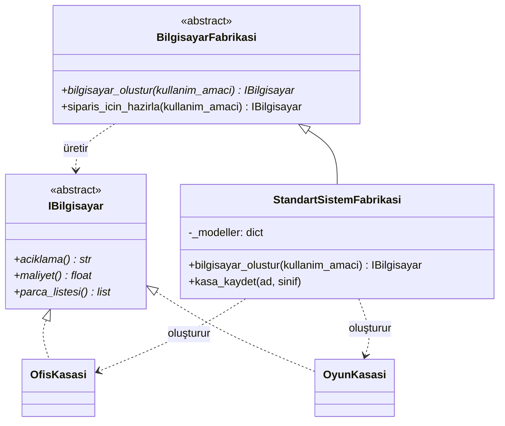
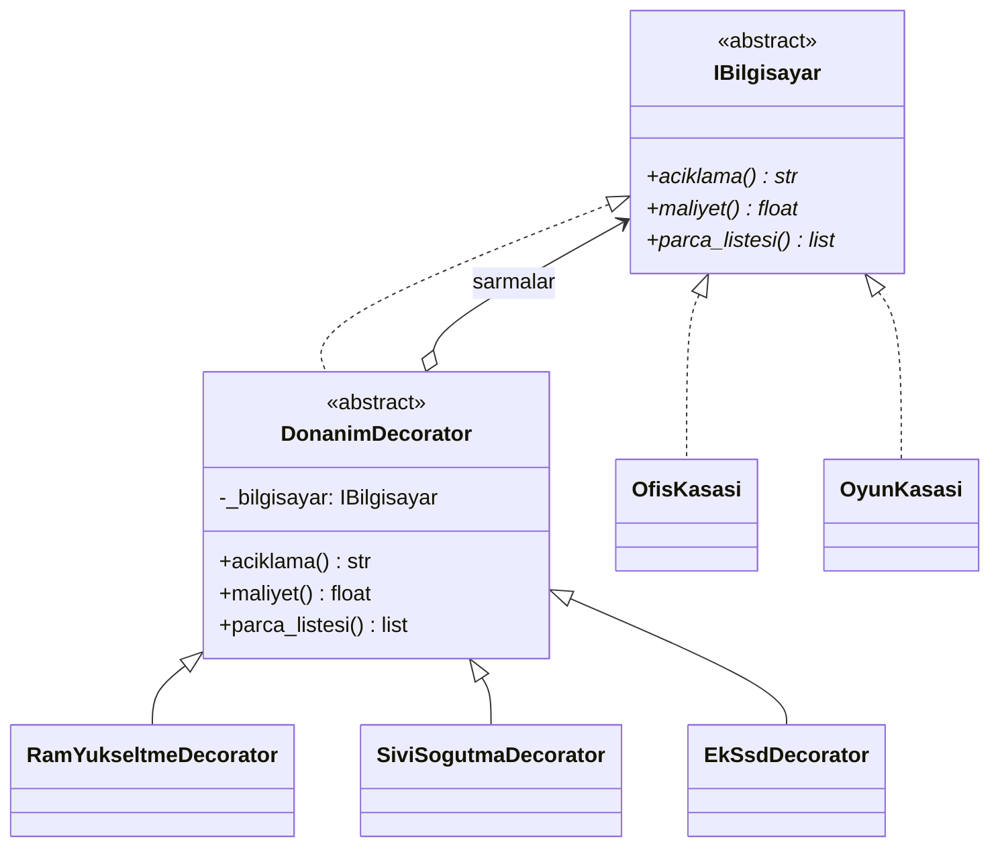
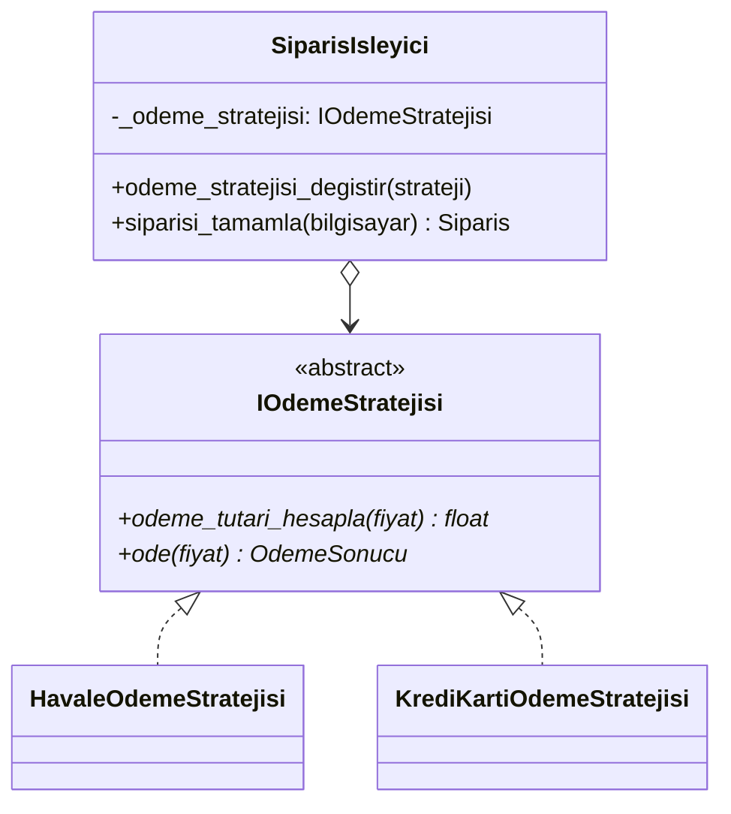
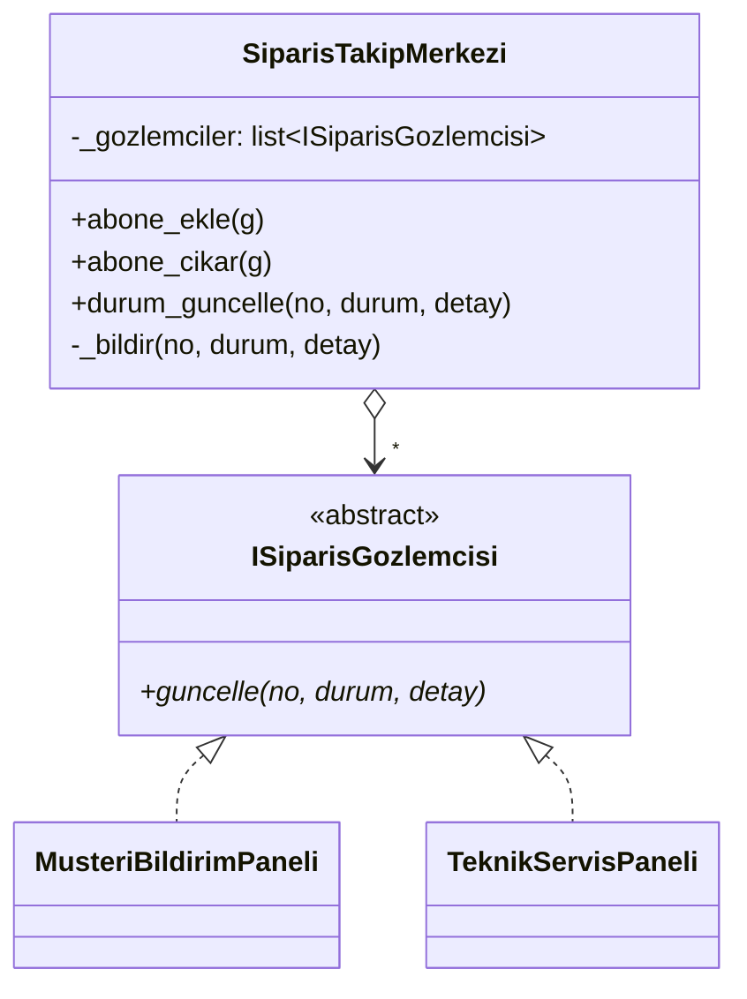
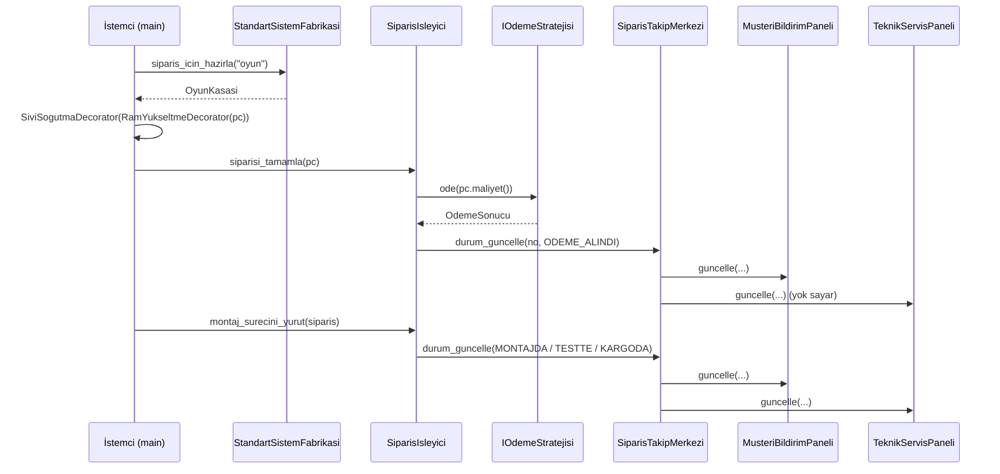

# Kalıp Haritası

Her kalıp için: çözülen problem, katılımcı roller ve karşılayan sınıf/dosya,
UML sınıf diyagramı, değerlendirilen alternatif ve seçilen çözümün bedeli.

---

## 1. Factory Method (Yaratımsal)

**Problem:** İstemci `OfisKasasi()` / `OyunKasasi()` gibi somut sınıfları doğrudan
oluşturursa yeni bir kasa modeli eklendiğinde istemci kodu değişmek zorunda kalır.

| Rol | Sınıf | Dosya |
|---|---|---|
| Creator | `BilgisayarFabrikasi` | `pc_siparis/fabrika.py` |
| ConcreteCreator | `StandartSistemFabrikasi` | `pc_siparis/fabrika.py` |
| Product | `IBilgisayar` | `pc_siparis/urunler.py` |
| ConcreteProduct | `OfisKasasi`, `OyunKasasi` | `pc_siparis/urunler.py` |

**Alternatif:** Simple Factory (tek bir statik `if/else` fonksiyonu) veya istemcide doğrudan `new`.
**Bedel:** Ek soyut sınıf ve dolaylılık katmanı; küçük sistemde fazladan sınıf.

---

## 2. Decorator (Yapısal)

**Problem:** RAM, sıvı soğutma, ek SSD gibi opsiyonların her kombinasyonu için alt sınıf
açmak (`OyunKasasiRamSogutma`, ...) sınıf patlamasına yol açar.

| Rol | Sınıf | Dosya |
|---|---|---|
| Component | `IBilgisayar` | `pc_siparis/urunler.py` |
| ConcreteComponent | `OfisKasasi`, `OyunKasasi` | `pc_siparis/urunler.py` |
| Decorator | `DonanimDecorator` | `pc_siparis/dekoratorler.py` |
| ConcreteDecorator | `RamYukseltmeDecorator`, `SiviSogutmaDecorator`, `EkSsdDecorator` | `pc_siparis/dekoratorler.py` |

**Alternatif:** Kalıtımla her kombinasyon için alt sınıf; ya da kasada boolean bayraklar (`ram_var`, `sogutma_var`).
**Bedel:** Çok sayıda küçük nesne; sarmalama sırası hata ayıklamayı zorlaştırabilir; tip kontrolü (`isinstance(pc, OyunKasasi)`) dekore edilmiş nesnede çalışmaz.

---

## 3. Strategy (Davranışsal)

**Problem:** Havale indirimi, kredi kartı taksiti gibi ödeme kuralları `SiparisIsleyici` içinde
`if/else` ile yazılırsa her yeni yöntem bu sınıfı değiştirir.

| Rol | Sınıf | Dosya |
|---|---|---|
| Context | `SiparisIsleyici` | `pc_siparis/siparis.py` |
| Strategy | `IOdemeStratejisi` | `pc_siparis/odeme.py` |
| ConcreteStrategy | `HavaleOdemeStratejisi`, `KrediKartiOdemeStratejisi` | `pc_siparis/odeme.py` |

**Alternatif:** `if odeme_tipi == "havale": ...` zinciri; veya strateji yerine lambda (dile gömülü karşılık — kullanılmadı).
**Bedel:** İstemcinin hangi stratejiyi seçeceğini bilmesi gerekir; her yöntem için ek sınıf.

---

## 4. Observer (Davranışsal)

**Problem:** Montaj/test/kargo aşamaları değiştiğinde sipariş akışı müşteri ekranını, teknik
servis panelini vb. doğrudan çağırırsa her yeni bildirim kanalı sipariş kodunu değiştirir.

| Rol | Sınıf | Dosya |
|---|---|---|
| Subject | `SiparisTakipMerkezi` | `pc_siparis/takip.py` |
| Observer | `ISiparisGozlemcisi` | `pc_siparis/takip.py` |
| ConcreteObserver | `MusteriBildirimPaneli`, `TeknikServisPaneli` | `pc_siparis/takip.py` |

### Sıralama Diyagramı — siparişin tamamlanması

**Alternatif:** Sipariş akışında panellerin doğrudan çağrılması; veya bir kütüphanenin hazır olay sistemi (müfredat gereği sayılmaz).
**Bedel:** Bildirim sırası garanti değildir; çok sayıda gözlemcide performans ve hata ayıklama zorlaşır; abonelikten çıkılmazsa bellek tutulur.

---

## Kapsam/Kural Değişiklikleri

| Değişiklik | Eklenen sınıflar | Değiştirilen sınıflar | Karşılayan kalıp |
|---|---|---|---|
| 1. değişiklik (10.–11. hafta) | — | — | — |
| 2. değişiklik (14.–15. hafta) | — | — | — |
