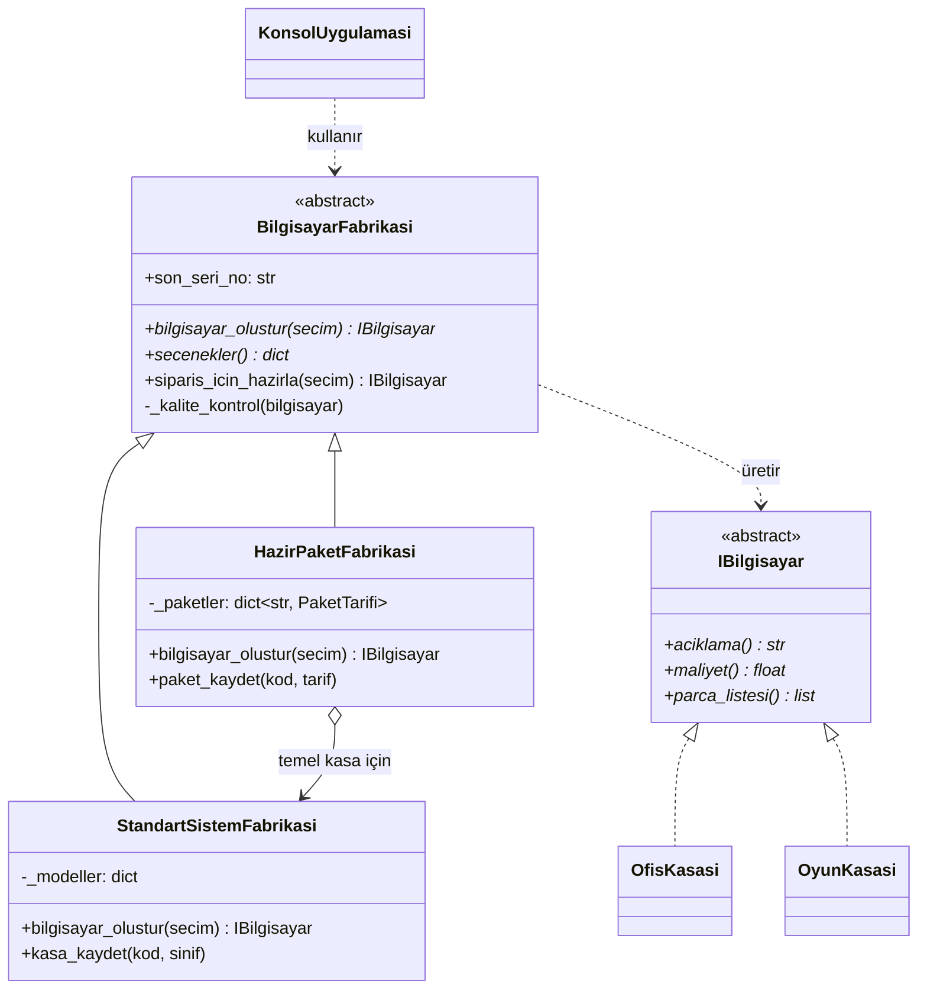
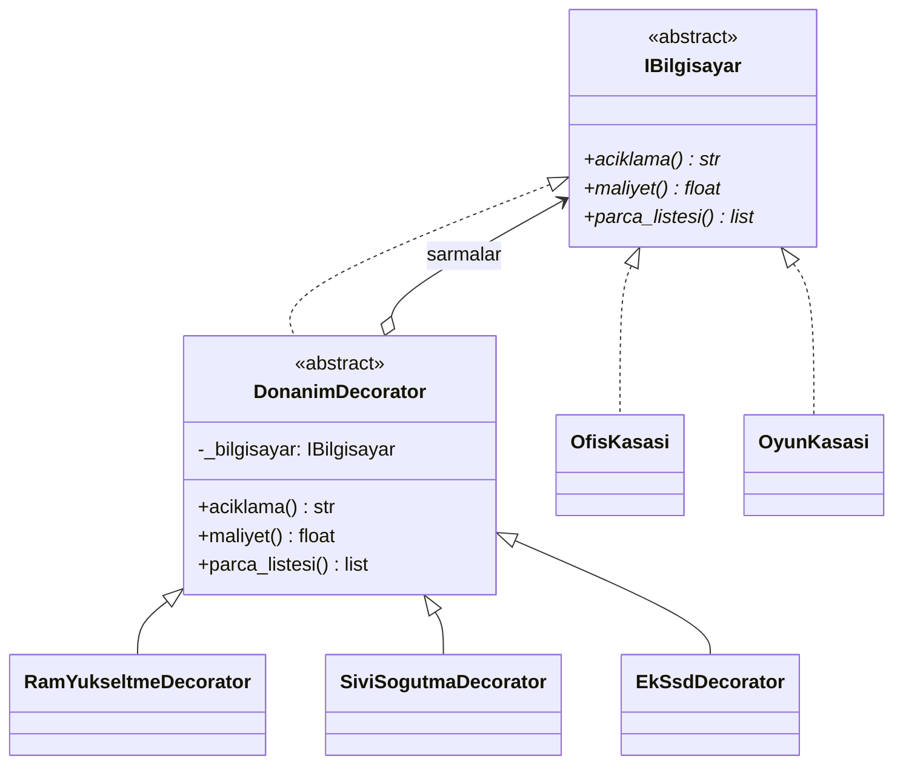
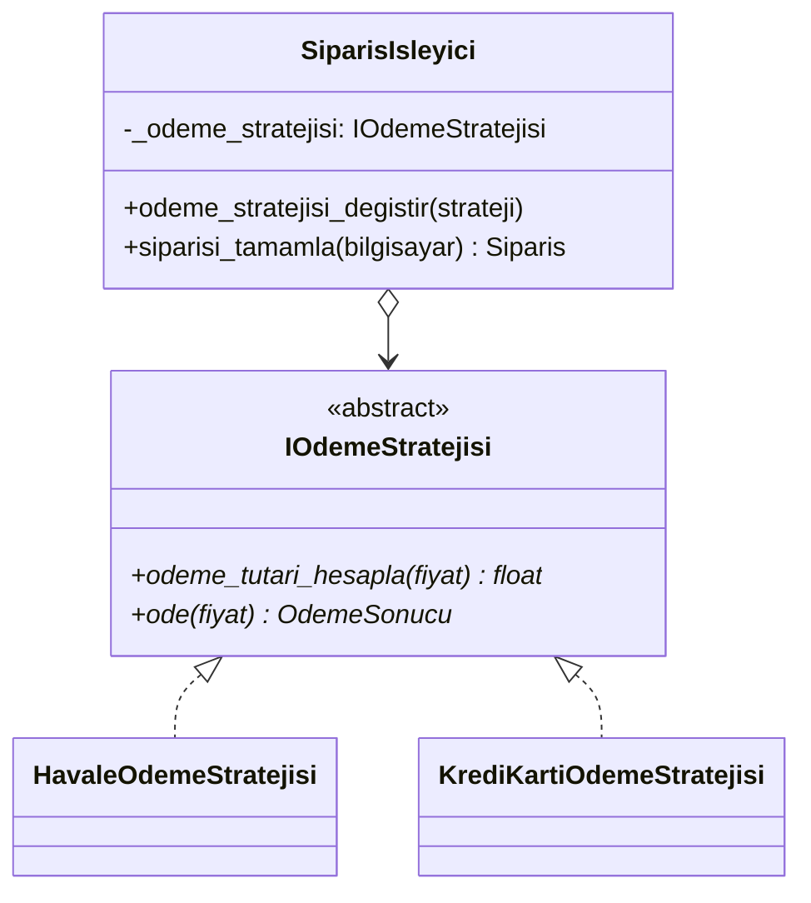
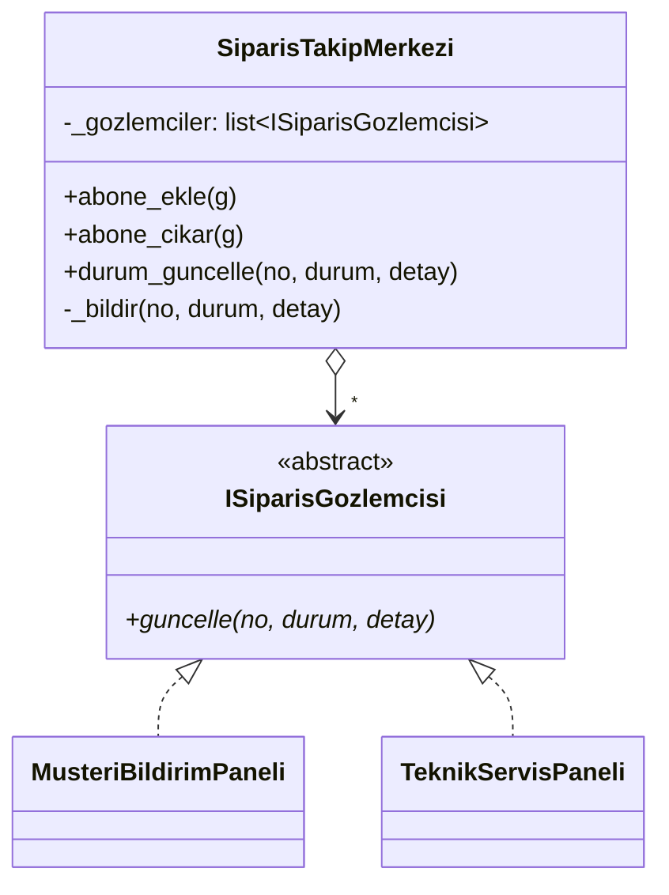
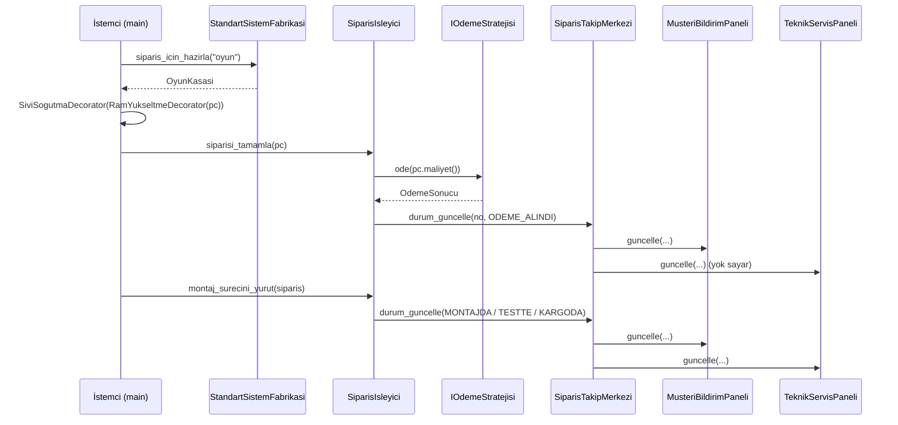
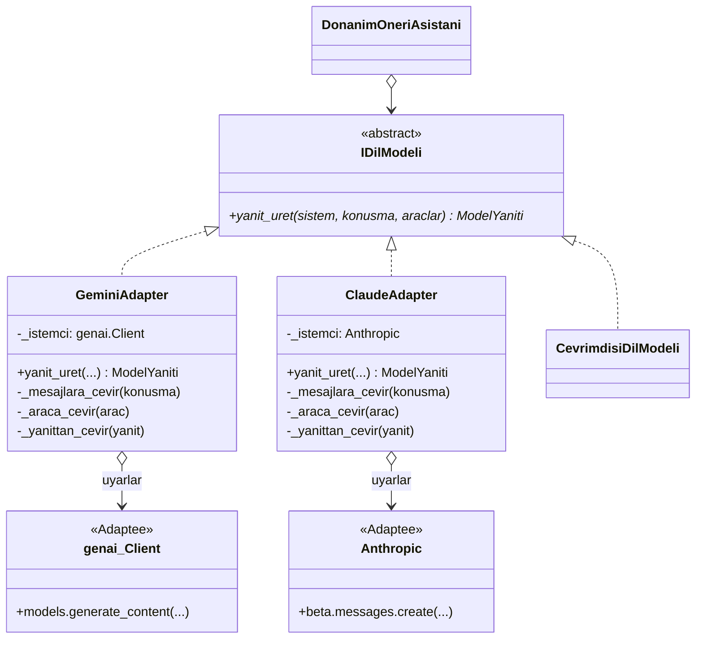
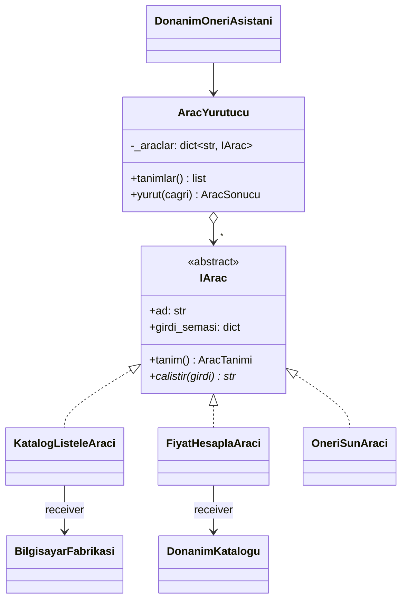
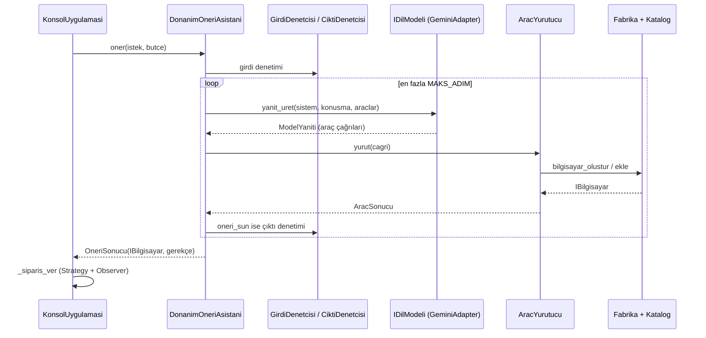

# Kalıp Haritası

Her kalıp için: çözülen problem, katılımcı roller ve karşılayan sınıf/dosya,
UML sınıf diyagramı, değerlendirilen alternatif ve seçilen çözümün bedeli.

---

## 1. Factory Method (Yaratımsal)

**Problem:** Sistem iki farklı türde ürün sunar: temel kasalar ve önceden yapılandırılmış
hazır paketler. İstemci (konsol arayüzü, AI asistanı) bunları somut sınıflarla oluşturursa
her yeni model veya paket türünde istemci kodu değişir. Ayrıca kalite kontrol ve seri
numarası verme gibi üretim adımlarının her ürün türü için tekrar yazılması gerekir.

**Çözüm:** `BilgisayarFabrikasi.siparis_icin_hazirla` ortak süreci (üret → kalite kontrol →
seri no) bir kez tanımlar; yalnızca "ne üretileceği" (`bilgisayar_olustur`) alt sınıflara
bırakılır. Konsol arayüzü `_fabrikadan_al(fabrika)` metodunda hangi fabrika verilirse verilsin
aynı kodu çalıştırır.

| Rol | Sınıf | Dosya |
|---|---|---|
| Creator | `BilgisayarFabrikasi` | `pc_siparis/fabrika.py` |
| ConcreteCreator | `StandartSistemFabrikasi`, `HazirPaketFabrikasi` | `pc_siparis/fabrika.py` |
| Product | `IBilgisayar` | `pc_siparis/urunler.py` |
| ConcreteProduct | `OfisKasasi`, `OyunKasasi` (+ dekore edilmiş paketler) | `pc_siparis/urunler.py` |
| İstemci | `KonsolUygulamasi._fabrikadan_al`, `PencereUygulamasi._fabrika_sekmesi` | `pc_siparis/konsol.py`, `pc_siparis/pencere.py` |

**Alternatif:** Simple Factory (tek bir `if/else` fonksiyonu) veya istemcide doğrudan nesne oluşturma.
**Bedel:** Ek soyut sınıf ve dolaylılık katmanı; fabrika ve ürün hiyerarşileri birlikte büyür.

---

## 2. Decorator (Yapısal)

**Problem:** RAM, sıvı soğutma, ek SSD gibi opsiyonların her kombinasyonu için alt sınıf
açmak (`OyunKasasiRamSogutma`, ...) sınıf patlamasına yol açar.

| Rol | Sınıf | Dosya |
|---|---|---|
| Component | `IBilgisayar` | `pc_siparis/urunler.py` |
| ConcreteComponent | `OfisKasasi`, `OyunKasasi` | `pc_siparis/urunler.py` |
| Decorator | `DonanimDecorator` | `pc_siparis/dekoratorler.py` |
| ConcreteDecorator | `RamYukseltmeDecorator`, `SiviSogutmaDecorator`, `EkSsdDecorator` | `pc_siparis/dekoratorler.py` |

**Alternatif:** Kalıtımla her kombinasyon için alt sınıf; ya da kasada boolean bayraklar (`ram_var`, `sogutma_var`).
**Bedel:** Çok sayıda küçük nesne; sarmalama sırası hata ayıklamayı zorlaştırabilir; tip kontrolü (`isinstance(pc, OyunKasasi)`) dekore edilmiş nesnede çalışmaz.

---

## 3. Strategy (Davranışsal)

**Problem:** Havale indirimi, kredi kartı taksiti gibi ödeme kuralları `SiparisIsleyici` içinde
`if/else` ile yazılırsa her yeni yöntem bu sınıfı değiştirir.

| Rol | Sınıf | Dosya |
|---|---|---|
| Context | `SiparisIsleyici` | `pc_siparis/siparis.py` |
| Strategy | `IOdemeStratejisi` | `pc_siparis/odeme.py` |
| ConcreteStrategy | `HavaleOdemeStratejisi`, `KrediKartiOdemeStratejisi` | `pc_siparis/odeme.py` |

**Alternatif:** `if odeme_tipi == "havale": ...` zinciri; veya strateji yerine lambda (dile gömülü karşılık — kullanılmadı).
**Bedel:** İstemcinin hangi stratejiyi seçeceğini bilmesi gerekir; her yöntem için ek sınıf.

---

## 4. Observer (Davranışsal)

**Problem:** Montaj/test/kargo aşamaları değiştiğinde sipariş akışı müşteri ekranını, teknik
servis panelini vb. doğrudan çağırırsa her yeni bildirim kanalı sipariş kodunu değiştirir.

| Rol | Sınıf | Dosya |
|---|---|---|
| Subject | `SiparisTakipMerkezi` | `pc_siparis/takip.py` |
| Observer | `ISiparisGozlemcisi` | `pc_siparis/takip.py` |
| ConcreteObserver | `MusteriBildirimPaneli`, `TeknikServisPaneli` | `pc_siparis/takip.py` |
| ConcreteObserver (pencere) | `SiraliGosterimGozlemcisi` (takip merkezine abone olur, bildirimleri aşağıdaki panellere aralıklarla iletir), `PencereMusteriPaneli`, `PencereTeknikServisPaneli`, `SiparisDurumGostergesi` | `pc_siparis/pencere.py` |

### Sıralama Diyagramı — siparişin tamamlanması

**Kalıbın kazancı (pencere arayüzü):** Pencere arayüzü eklenirken sipariş akışı ve takip merkezi
hiç değiştirilmedi; yalnızca yeni ConcreteObserver'lar yazılıp `abone_ekle` ile kaydedildi. Aşamaların
ekranda sırayla canlandırılması da yalnızca yeni bir gözlemciyle (`SiraliGosterimGozlemcisi`) yapıldı.

**Alternatif:** Sipariş akışında panellerin doğrudan çağrılması; veya bir kütüphanenin hazır olay sistemi (müfredat gereği sayılmaz).
**Bedel:** Bildirim sırası garanti değildir; çok sayıda gözlemcide performans ve hata ayıklama zorlaşır; abonelikten çıkılmazsa bellek tutulur.

---

## 5. Adapter (Yapısal) — AI asistanı

**Problem:** Asistan, bir LLM sağlayıcısının SDK'sına (mesaj/blok formatı, hata sınıfları)
doğrudan bağlı olursa SDK değişikliğinde veya başka bir modele geçişte asistan kodu
değişir; ayrıca API anahtarı olmadan çalıştırılamaz ve test edilemez.

**Kalıbın kazancı:** Proje Claude ile başladı, sonra varsayılan model Gemini'ye çevrildi. Bu
değişiklikte yalnızca `GeminiAdapter` eklendi ve model seçim fonksiyonu güncellendi;
asistan, araçlar, guardrail'ler ve arayüzler hiç değişmedi.

| Rol | Sınıf | Dosya |
|---|---|---|
| Target | `IDilModeli` | `pc_siparis/ai/dil_modeli.py` |
| Adapter | `GeminiAdapter` (varsayılan), `ClaudeAdapter` | `pc_siparis/ai/dil_modeli.py` |
| Adaptee | `google.genai.Client` (Google Gen AI SDK), `anthropic.Anthropic` (Anthropic SDK) | harici kütüphaneler |
| Client | `DonanimOneriAsistani` | `pc_siparis/ai/asistan.py` |
| Target'ın alternatif uygulaması | `CevrimdisiDilModeli` (anahtarsız, kural tabanlı) | `pc_siparis/ai/dil_modeli.py` |

**Alternatif:** Asistanın SDK'yı doğrudan çağırması.
**Bedel:** Çeviri katmanı ve sağlayıcıdan bağımsız veri tipleri (`ModelYaniti`, `AracCagrisi`)
bakım gerektirir; SDK'nın yeni özellikleri arayüze eklenene kadar kullanılamaz.

---

## 6. Command (Davranışsal) — AI araçları

**Problem:** Dil modeli, adı ve JSON girdisi olan istekler ("katalog_listele", "fiyat_hesapla",
"oneri_sun") üretir. Bu istekleri `if ad == ...` zinciriyle karşılamak asistanı her yeni
araçta değiştirmeyi gerektirir ve isteği, onu yerine getiren nesneye (fabrika, katalog) sıkı bağlar.

| Rol | Sınıf | Dosya |
|---|---|---|
| Command | `IArac` | `pc_siparis/ai/araclar.py` |
| ConcreteCommand | `KatalogListeleAraci`, `FiyatHesaplaAraci`, `OneriSunAraci` | `pc_siparis/ai/araclar.py` |
| Invoker | `AracYurutucu` | `pc_siparis/ai/araclar.py` |
| Receiver | `BilgisayarFabrikasi`, `DonanimKatalogu` | `pc_siparis/fabrika.py`, `pc_siparis/katalog.py` |
| Client | `DonanimOneriAsistani` (komutları oluşturup Invoker'a verir) | `pc_siparis/ai/asistan.py` |

**Alternatif:** Asistanda araç adına göre `if/elif` ile dallanma.
**Bedel:** Her araç için ayrı sınıf; komutun şeması (JSON Schema) ile kodu ayrı yerlerde
tutarlı tutulmalıdır.

---

## 7. LLM Kalıpları (ek puan kapsamı)

| Kalıp | Nerede | Çözdüğü problem |
|---|---|---|
| **Tool Use / Function Calling** | `ai/araclar.py`, `ai/asistan.py` | Model fiyat ve parça bilgisini "uydurmak" yerine gerçek kataloğu araçlarla sorgular; fiyatlar Factory Method + Decorator ile hesaplanır. Nihai öneri serbest metin yerine `oneri_sun` aracıyla yapılandırılmış (strict JSON Schema) teslim edilir. |
| **ReAct benzeri döngü** | `DonanimOneriAsistani.oner` | Model düşünür → araç çağırır → sonucu gözlemler → karar verir; en fazla `MAKS_ADIM` adım. |
| **Guardrail** | `ai/guardrail.py` | Girdi: boş/uzun istek ve prompt-injection ifadeleri modele gitmeden reddedilir. Çıktı: katalogda olmayan parça veya bütçe aşımı kabul edilmez; hata modele geri bildirilir, model düzeltir. |

AI asistanının önerdiği sistem sıradan bir `IBilgisayar` olduğundan sipariş akışı
(Strategy, Observer) hiç değiştirilmeden kullanılır.

### Sıralama Diyagramı — AI önerisi

---

## Kapsam/Kural Değişiklikleri

| Değişiklik | Eklenen sınıflar | Değiştirilen sınıflar | Karşılayan kalıp |
|---|---|---|---|
| 1. değişiklik (10.–11. hafta) | — | — | — |
| 2. değişiklik (14.–15. hafta) | — | — | — |
